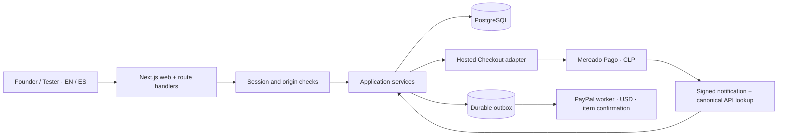

# Architecture and contracts

## Decision

Modular TypeScript monolith: Next.js App Router for the bilingual web UI and HTTP transport; server-only application services for identity, profiles, studies, work review, and finance. PostgreSQL is the source of truth. SQL migrations, database constraints, transaction-scoped services, and tests are written before the UI. This avoids premature distributed transactions and allows services to be extracted later without moving financial rules into components.

Node 24, React, Next.js, Zod at input boundaries, `pg` in production, PGlite (actual PostgreSQL engine compiled to WASM) for isolated tests and local development, Vitest for domain/integration tests, Playwright for browser flows, server-only HTTP adapters for Mercado Pago Checkout Pro and PayPal Payouts. Versions are pinned in `package-lock.json`; do not dynamically install `latest` in CI or production.

## Models

Users, hashed sessions, one-time OAuth states, tester profiles, studies, immutable study tasks after funding, applications, participations, daily check-ins, task submissions, payments/quote snapshots, webhook inbox, ledger transactions/entries, reward obligations, disputes, outbox jobs, audit events, and login rate limits.

All persisted instants are UTC. A test day is a UTC calendar day, displayed as such. Duration is also checked as elapsed 24-hour periods, so making check-ins around midnight cannot satisfy a fourteen-day study early. User-facing dates are formatted in the selected locale. A study owns its quote/policy snapshot; changing global fees never reprices funded work.

## State machines

Study: `draft → recruiting → active → completed`; future cancellation requires refund accounting. Active studies still accept applicants when seats are available. Payments: `pending → succeeded`; mismatched webhook events cannot transition. Application: `applied → accepted | rejected`, accepted creates participation. Participation: `accepted → active → submitted → approved | rejected`; rejected may become `disputed` and resubmit after feedback; rewards: `pending → processing → paid | failed`, with live transitions gated.

Each mutation checks the current state inside a transaction. PostgreSQL row locks serialize seat allocation, funding, and reward approval. PGlite serializes test/local transactions. Unique constraints make duplicate applications, check-ins, task answers, rewards, and provider payment IDs independently impossible. An immutable balanced journal records money movements; rewards are obligations, not evidence of payout.

## HTTP surface

`GET /api/health`; `POST /api/auth/register`, `/login`, `/logout`; Google start/callback; `GET /api/me`; `PUT /api/profile`; `GET/POST /api/studies`; `POST /api/quote`; `GET /api/studies/:id`; `POST /api/studies/:id/checkout`, `/sandbox-fund`, `/apply`; `POST /api/applications/:id/review`; `GET /api/participations`; `POST /api/participations/:id/start`, `/check-in`, `/tasks`, `/submit`, `/review`, `/dispute`; `GET /api/dashboard`, `/api/wallet`; `POST /api/webhooks/mercadopago`.

POST/PUT requests use JSON, schema validation and a same-origin check. Auth derives exclusively from an opaque, cryptographically random cookie whose digest is stored server-side. Sessions use HttpOnly, SameSite=Lax and Secure in production. All private reads perform authorization too. Errors contain stable codes and no SQL/provider secrets. Auth requests use per-IP persistent throttling, with deployment proxy assumptions documented.

## Deployment and capability modes

Production: Railway web service + managed PostgreSQL, private database URL, migrations in startup (advisory-lock serialized), health check. No local memory state or filesystem uploads are required. `APP_MODE=sandbox` disables real collection and live payouts. Embedded development data is in ignored `.local/`; it is never silently used as a production fallback. `APP_MODE=live` fails its payment capability check until required providers, operational gates, and account settings are configured. A web process may run in live mode without payments enabled; checkout returns a clear unavailable error.

Google OIDC is optional; the UI only offers it when configured. Password sign-in is usable without third-party credentials. Payment capability and app mode are exposed to the UI without secrets. Demo examples are labeled and separately seeded; a fresh real account starts with real zero-state metrics.

## Chile payment boundary

USD cents are the contract/accounting unit. Mercado Pago Chile receipts are CLP integer pesos with a frozen, explicitly configured FX quote in `payments.collection_amount_minor` and `fx_rate_scaled`. Missing FX is an error, never a guessed rate. Notification HMAC binds data ID, request ID and timestamp; the adapter retrieves the payment from Mercado Pago and verifies approval, receipt currency/amount, external reference, and sandbox/live mode.

PayPal uses one stable sender batch ID per reward. The outbox leases jobs before external work, persists the provider batch ID, polls item status and confirms recipient/currency/amount before the payout journal. A batch-level success is insufficient. Ambiguous results remain pending/retry; failures require reconciliation with the existing batch identity. No external provider call is made inside a long database transaction. A Mercado Pago balance is not a PayPal USD balance: provider cash, FX conversion and treasury reconciliation remain distinct.
